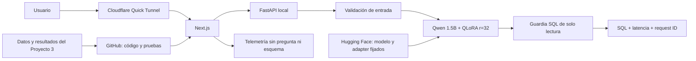

# Proyecto Final — Text-to-SQL con QLoRA en producción

Aplicación que convierte un esquema relacional y una pregunta en español en una consulta MySQL
de solo lectura. El proyecto lleva a producción el modelo desarrollado en el Proyecto 3 sin
presentar un modelo nuevo: conserva los datos, el protocolo experimental y el adaptador ganador,
y añade una interfaz pública, controles de entrada, telemetría y evidencia operativa.

<div align="center">
  <strong>Qwen2.5-Coder-1.5B + QLoRA r=32</strong><br>
  <code>MySQL 8.4</code> · <code>Gradio</code> · <code>FastAPI</code> · <code>Next.js</code>
</div>

> **Estado al 5 de noviembre de 2026:** entrega técnica completa. La aplicación pública temporal,
> tres inferencias reales, los controles de seguridad y el cierre del túnel quedaron documentados.
> Wilson y su agente solo realizarán una auditoría independiente en Markdown, sin editar el proyecto.

## Vista rápida

| Datos congelados | Calidad | Servicio | Verificación local |
|---:|---:|---|---:|
| 2,592 pares · 12 esquemas | 97.4% EX ponderada | Next.js + FastAPI + RTX 4050 | 43 pruebas aprobadas |
| 40 preguntas · 2 esquemas inéditos | 39/40 correctas | SQL de solo lectura | HTTP 200 público verificado |

**Navegación:** [problema](#1-problemática) · [plan](#2-planificación) ·
[modelo](#4-modelo-planteado) · [validación](#5-validación-de-hipótesis) ·
[arquitectura](#6-herramientas-y-arquitectura) ·
[evidencias](#7-evidencias-del-pase-a-producción) · [ejecución](#ejecución)

## Equipo

- Wilson Alejandro Calderón Argueta — 22018.
- Pablo Daniel Barillas Moreno — 22193.

El repositorio heredado del Proyecto 3 identifica a estos dos integrantes. El enunciado general del
Proyecto Final menciona tríos; no se añadió un tercer integrante ficticio ni se le atribuyó trabajo.

## 1. Problemática

Una persona que conoce los datos de su organización, pero no domina SQL, depende de un especialista
para responder preguntas operativas. El sistema recibe el DDL del esquema y una pregunta en español,
y propone una consulta MySQL que el usuario puede revisar, copiar o validar.

El usuario objetivo es un analista o responsable operativo con autorización para consultar la base.
La decisión apoyada por el modelo es qué consulta de solo lectura ejecutar para obtener la información
solicitada. El sistema no ejecuta cambios, no sustituye permisos de base de datos y no garantiza por
sí solo que una consulta semánticamente válida responda la intención del usuario.

## 2. Planificación

El plan completo se mantiene en [`docs/PLAN_PROYECTO_FINAL.md`](docs/PLAN_PROYECTO_FINAL.md). La
versión técnica quedó cerrada el **5 de noviembre**. Se mantiene el **9 de noviembre** como fecha de
congelamiento para exposición y el **15 de noviembre de 2026 a las 23:59** como entrega definitiva.

| Etapa | Fecha objetivo | Resultado |
|---|---:|---|
| Migración y trazabilidad | 2–3 nov | Código, datos y hashes del Proyecto 3 verificados |
| Aplicación y controles | 4 nov | Flujo web, SQL seguro y telemetría privada |
| Despliegue | 5 nov | HTTP 200 público, tres casos sintéticos y cierre verificado |
| Evidencia y documentación | 5 nov | Logs, capturas, pruebas y siete secciones del README |
| Presentación e informe | 5 nov | PDF de presentación e informe compilado |
| Congelamiento | 9 nov | Release candidata lista para el sorteo |
| Ajustes finales | 10–15 nov | Correcciones sin cambiar el alcance experimental |

## 3. Supuestos

- El usuario proporciona un esquema que contiene al menos una sentencia `CREATE TABLE`.
- La pregunta está en español y se refiere únicamente a tablas y columnas del esquema.
- El dialecto de destino es MySQL 8.4 y la salida debe ser una sola consulta de lectura.
- La aplicación no recibe credenciales ni se conecta a una base de negocio en el despliegue público.
- El proveedor puede asignar GPU bajo demanda; un arranque en frío o una cola pueden aumentar la
  latencia de la primera solicitud.
- El servicio procesa una generación a la vez para proteger el runtime de GPU.
- La telemetría registra tamaños, latencia y categoría de error, pero no el esquema ni la pregunta.
- Los datos sintéticos y los dos esquemas inéditos de validación no cubren todos los dominios reales.

## 4. Modelo planteado

El origen es el Proyecto 3, commit
`df34c14c5afecddaa0d977832a56cec80c590244`. El modelo base es
[`Qwen/Qwen2.5-Coder-1.5B-Instruct`](https://huggingface.co/Qwen/Qwen2.5-Coder-1.5B-Instruct),
fijado a una revisión inmutable. El adaptador ganador es QLoRA `r=32`, publicado en
[`Dani0604/proyecto3-text2sql-qlora`](https://huggingface.co/Dani0604/proyecto3-text2sql-qlora)
y fijado a la revisión indicada en `config.json`.

No se reentrena el modelo para este proyecto. Los cambios se concentran en producción:

- recuperación del adaptador desde Hugging Face cuando no hay pesos locales;
- interfaz Next.js pública mediante túnel temporal y Gradio preparado para Hugging Face Spaces;
- validación de tamaño y estructura de entradas;
- guardia que acepta únicamente `SELECT` o `WITH ... SELECT`;
- respuesta con identificador, variante y latencia;
- telemetría sin texto de usuario.

## 5. Validación de hipótesis

Antes del entrenamiento se registraron dos criterios principales:

- EX ponderada con adaptador `>= 0.70`;
- mejora absoluta sobre el baseline `>= 0.15`.

| Variante | EX ponderada | SQL ejecutable | Latencia p95 |
|---|---:|---:|---:|
| Qwen base | 3.8% | 62.5% | 6,656 ms |
| QLoRA `r=16` | 97.4% | 97.5% | 15,719 ms |
| QLoRA `r=32` | 97.4% | 97.5% | 13,197 ms |

La hipótesis de que `r=32` mejoraría la exactitud frente a `r=16` no se confirmó: ambos obtuvieron
39/40 respuestas correctas. Se seleccionó `r=32` por su menor p95 después del empate en calidad y
ejecutabilidad. Frente al baseline, el adaptador sí superó ampliamente los dos criterios de éxito.

La evidencia numérica está versionada en `resultados/`; los criterios previos al entrenamiento se
conservan en [`docs/PLAN_PROYECTO_3.md`](docs/PLAN_PROYECTO_3.md).

## 6. Herramientas y arquitectura



| Capa | Herramientas |
|---|---|
| Datos y evaluación | JSONL, MySQL 8.4, pandas, notebooks |
| Modelo | PyTorch, Transformers, PEFT, bitsandbytes, QLoRA |
| Servicio y UI | FastAPI, Next.js y Gradio |
| Acceso público verificado | Cloudflare Quick Tunnel sobre la RTX 4050 local |
| Ruta permanente preparada | Bundle Gradio para Hugging Face Spaces/ZeroGPU |
| Seguridad | sqlglot, sentencia única, lista de operaciones de lectura |
| Calidad | pytest, Ruff, pruebas de contrato y auditoría |
| Observabilidad | JSON Lines con request ID, latencia, estado y categoría de error |

La descripción ampliada está en [`docs/ARQUITECTURA.md`](docs/ARQUITECTURA.md).

### Decisiones de ingeniería

| Decisión | Razón | Consecuencia aceptada |
|---|---|---|
| Reutilizar el modelo del Proyecto 3 | El objetivo pide producción, no un modelo nuevo | El esfuerzo se concentra en servicio y evidencia |
| Publicar Next.js mediante túnel para la prueba | Reutiliza la UI validada y evita alterar el entorno CUDA | La URL cambia en cada demostración |
| Conservar Gradio para Spaces | Mantiene una ruta compatible con ZeroGPU | El Space espera elegibilidad de la cuenta |
| Descargar el adaptador fijado | Evita duplicar 140.9 MB en GitHub | La primera carga depende de Hugging Face |
| Procesar una solicitud a la vez | Protege memoria y estado del runtime | Menor concurrencia, adecuada para la demostración |
| Omitir texto en telemetría | Reduce exposición de esquemas potencialmente sensibles | El diagnóstico usa tamaños, estado y request ID |

## 7. Evidencias del pase a producción

Toda evidencia marcada como completa proviene de la ejecución real del 5 de noviembre de 2026. La
URL fue temporal y se cerró después de la prueba, como exige el procedimiento de seguridad.

| Evidencia | Estado | Ubicación |
|---|---|---|
| Aplicación pública temporal | Verificada, HTTP 200 | `docs/evidencias/despliegue.md` |
| Pruebas unitarias y de seguridad | 43 aprobadas | `tests/` |
| Logs sin datos de usuario | Implementado localmente | `logs/usage.jsonl` (no versionado) |
| Smoke test local con RTX 4050 | Aprobado, 65.1 s en primera carga | `docs/evidencias/pruebas/` |
| Evento anonimizado local | Registrado | `docs/evidencias/logs/` |
| Capturas de uso real | Registradas y revisadas | `docs/evidencias/capturas/` |
| Resultados sintéticos | 3/3 correctos | `docs/evidencias/pruebas/` |
| Controles destructivos | 2/2 rechazados con HTTP 422 | `docs/evidencias/pruebas/` |
| Commit desplegado | `0e304a20...66cf3a8` | `docs/evidencias/despliegue.md` |

## Ejecución

### Pruebas rápidas sin cargar el modelo

```powershell
py -3.11 -m venv .venv
.\.venv\Scripts\python.exe -m pip install -r requirements-dev.txt
.\.venv\Scripts\python.exe -m pytest -q
```

### Aplicación Gradio con el modelo real

Requiere una GPU NVIDIA compatible para una experiencia local práctica. La primera ejecución
descarga el modelo base y el adaptador fijado.

```powershell
.\.venv\Scripts\python.exe -m pip install -r requirements-space.txt
.\.venv\Scripts\python.exe app.py
```

Abra `http://127.0.0.1:7860`. La aplicación usa `config.json`; `usar_adapter` debe permanecer en
`true` para la variante final.

### Construir el paquete de despliegue

```powershell
.\.venv\Scripts\python.exe scripts\build_space_bundle.py
```

El comando crea `dist/huggingface-space/` con únicamente el runtime, la interfaz, la configuración,
los metadatos del adaptador y las dependencias. No incluye pesos, notebooks ni datos de entrenamiento.

### Demostración pública reproducible

El Space ZeroGPU permanente sigue bloqueado por la antigüedad de la cuenta. La demostración usa
Next.js, FastAPI y Cloudflare con la RTX 4050 local:

```powershell
.\scripts\demo\start_demo.ps1
.\scripts\demo\verify_demo.ps1 -RunInference
.\scripts\demo\stop_demo.ps1
```

El primer comando imprime una URL `trycloudflare.com` y registra el commit exacto. El segundo valida
HTTP público, tres inferencias y dos rechazos de seguridad. El tercero detiene únicamente los PID
registrados y verifica que los puertos queden libres. Solo se permiten esquemas sintéticos.

La ejecución verificada produjo 43.0 s en carga fría, 3.0 s en el caso medio y 8.0 s en el difícil.
La URL histórica y las capturas están en [`docs/evidencias/despliegue.md`](docs/evidencias/despliegue.md).

### Guion de demostración

1. Abrir la nueva URL pública que imprime el script.
2. Confirmar que el ejemplo contiene dos tablas relacionadas.
3. Ejecutar una pregunta fácil, una media y una difícil.
4. Relacionar cada captura con su `request_id` y evento anonimizado.
5. Mostrar que una salida `DELETE` o una sentencia múltiple se rechaza en las pruebas.
6. Cerrar con las limitaciones y la recomendación de uso supervisado.

### Auditoría final

```powershell
python scripts\audit_final.py --final
```

El comando exige código, datos congelados, adaptador fijado, presentación e informe PDF, URL,
capturas, logs y pruebas de humo. El handoff de revisión independiente está en
[`docs/HANDOFF_WILSON.md`](docs/HANDOFF_WILSON.md).

### API y aplicación Next.js heredadas

La ruta FastAPI + Next.js sirve tanto para desarrollo local como para la demostración. Las instrucciones están en
[`web/README.md`](web/README.md) y la API expone `/health`, `/api/generate` y `/api/validate-sql`.

## Reproducibilidad y procedencia

Los datos, métricas y pesos no se regeneraron durante la migración. Sus conteos, hashes y revisiones
se documentan en [`docs/PROCEDENCIA.md`](docs/PROCEDENCIA.md). El binario del adaptador no se duplica
en este repositorio: se recupera de Hugging Face y se valida contra el SHA-256 registrado.

## Uso de inteligencia artificial

OpenAI Codex se utilizó para analizar el enunciado, planificar la adaptación, migrar código,
implementar controles de producción, preparar pruebas y apoyar la documentación. En el Proyecto 3,
v0 se utilizó como punto de partida visual de la interfaz. Los integrantes revisan los cambios y son
responsables de explicar el código, las métricas y las decisiones. Ninguna API de IA externa procesa
las solicitudes del servicio: la inferencia usa el modelo abierto y el adaptador descritos arriba.

## Limitaciones conocidas

- La validación propia contiene 40 preguntas sobre dos esquemas inéditos.
- Los datos son sintéticos y no representan todos los patrones de una organización real.
- El servicio genera SQL, pero no lo ejecuta contra una base pública.
- Una consulta segura puede ser semánticamente incorrecta; el usuario debe revisarla.
- El hardware bajo demanda puede introducir cola o arranque en frío.
- El runtime público prioriza demostración reproducible, no alta concurrencia.

Consulte también [`SECURITY.md`](SECURITY.md), [`CONTRIBUCIONES.md`](CONTRIBUCIONES.md) y
[`BITACORA.md`](BITACORA.md).
