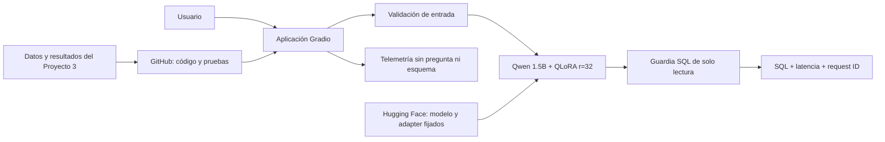

# Proyecto Final — Text-to-SQL con QLoRA en producción

Aplicación que convierte un esquema relacional y una pregunta en español en una consulta MySQL
de solo lectura. El proyecto lleva a producción el modelo desarrollado en el Proyecto 3 sin
presentar un modelo nuevo: conserva los datos, el protocolo experimental y el adaptador ganador,
y añade una interfaz pública, controles de entrada, telemetría y evidencia operativa.

**Estado al 2 de noviembre de 2026:** migración reproducible y aplicación de producción en
desarrollo. La URL pública todavía no se declara como evidencia hasta completar y verificar el
despliegue.

## Equipo

- Wilson Alejandro Calderón Argueta — 22018.
- Pablo Daniel Barillas Moreno — 22193.

El enunciado del Proyecto Final indica modalidad de tríos. La composición definitiva del equipo
debe confirmarse antes de congelar la portada y el reparto de la presentación.

## 1. Problemática

Una persona que conoce los datos de su organización, pero no domina SQL, depende de un especialista
para responder preguntas operativas. El sistema recibe el DDL del esquema y una pregunta en español,
y propone una consulta MySQL que el usuario puede revisar, copiar o validar.

El usuario objetivo es un analista o responsable operativo con autorización para consultar la base.
La decisión apoyada por el modelo es qué consulta de solo lectura ejecutar para obtener la información
solicitada. El sistema no ejecuta cambios, no sustituye permisos de base de datos y no garantiza por
sí solo que una consulta semánticamente válida responda la intención del usuario.

## 2. Planificación

El plan completo se mantiene en [`docs/PLAN_PROYECTO_FINAL.md`](docs/PLAN_PROYECTO_FINAL.md). La
versión lista para presentación debe quedar congelada el **9 de noviembre**; la entrega definitiva
es el **15 de noviembre de 2026 a las 23:59**.

| Etapa | Fecha objetivo | Resultado |
|---|---:|---|
| Migración y trazabilidad | 2–3 nov | Código, datos y hashes del Proyecto 3 verificados |
| Aplicación y controles | 4 nov | Flujo web, SQL seguro y telemetría privada |
| Despliegue | 5–6 nov | URL pública y prueba desde una sesión externa |
| Evidencia y documentación | 6–7 nov | Logs, capturas, pruebas y siete secciones del README |
| Presentación y ensayo | 8 nov | PDF, demostración y ensayo de 10 minutos |
| Congelamiento | 9 nov | Release candidata lista para el sorteo |
| Ajustes finales | 10–15 nov | Correcciones sin cambiar el alcance experimental |

## 3. Supuestos

- El usuario proporciona un esquema que contiene al menos una sentencia `CREATE TABLE`.
- La pregunta está en español y se refiere únicamente a tablas y columnas del esquema.
- El dialecto de destino es MySQL 8.4 y la salida debe ser una sola consulta de lectura.
- La aplicación no recibe credenciales ni se conecta a una base de negocio en el despliegue público.
- El proveedor puede asignar GPU bajo demanda; un arranque en frío o una cola pueden aumentar la
  latencia de la primera solicitud.
- El servicio procesa una generación a la vez para proteger el runtime de GPU.
- La telemetría registra tamaños, latencia y categoría de error, pero no el esquema ni la pregunta.
- Los datos sintéticos y los dos esquemas inéditos de validación no cubren todos los dominios reales.

## 4. Modelo planteado

El origen es el Proyecto 3, commit
`df34c14c5afecddaa0d977832a56cec80c590244`. El modelo base es
[`Qwen/Qwen2.5-Coder-1.5B-Instruct`](https://huggingface.co/Qwen/Qwen2.5-Coder-1.5B-Instruct),
fijado a una revisión inmutable. El adaptador ganador es QLoRA `r=32`, publicado en
[`Dani0604/proyecto3-text2sql-qlora`](https://huggingface.co/Dani0604/proyecto3-text2sql-qlora)
y fijado a la revisión indicada en `config.json`.

No se reentrena el modelo para este proyecto. Los cambios se concentran en producción:

- recuperación del adaptador desde Hugging Face cuando no hay pesos locales;
- interfaz Gradio compatible con GPU bajo demanda;
- validación de tamaño y estructura de entradas;
- guardia que acepta únicamente `SELECT` o `WITH ... SELECT`;
- respuesta con identificador, variante y latencia;
- telemetría sin texto de usuario.

## 5. Validación de hipótesis

Antes del entrenamiento se registraron dos criterios principales:

- EX ponderada con adaptador `>= 0.70`;
- mejora absoluta sobre el baseline `>= 0.15`.

| Variante | EX ponderada | SQL ejecutable | Latencia p95 |
|---|---:|---:|---:|
| Qwen base | 3.8% | 62.5% | 6,656 ms |
| QLoRA `r=16` | 97.4% | 97.5% | 15,719 ms |
| QLoRA `r=32` | 97.4% | 97.5% | 13,197 ms |

La hipótesis de que `r=32` mejoraría la exactitud frente a `r=16` no se confirmó: ambos obtuvieron
39/40 respuestas correctas. Se seleccionó `r=32` por su menor p95 después del empate en calidad y
ejecutabilidad. Frente al baseline, el adaptador sí superó ampliamente los dos criterios de éxito.

La evidencia numérica está versionada en `resultados/`; los criterios previos al entrenamiento se
conservan en [`docs/PLAN_PROYECTO_3.md`](docs/PLAN_PROYECTO_3.md).

## 6. Herramientas y arquitectura



| Capa | Herramientas |
|---|---|
| Datos y evaluación | JSONL, MySQL 8.4, pandas, notebooks |
| Modelo | PyTorch, Transformers, PEFT, bitsandbytes, QLoRA |
| Servicio local | FastAPI y Next.js heredados del Proyecto 3 |
| Servicio público | Gradio y Hugging Face Spaces/ZeroGPU |
| Seguridad | sqlglot, sentencia única, lista de operaciones de lectura |
| Calidad | pytest, Ruff, pruebas de contrato y auditoría |
| Observabilidad | JSON Lines con request ID, latencia, estado y categoría de error |

La descripción ampliada está en [`docs/ARQUITECTURA.md`](docs/ARQUITECTURA.md).

## 7. Evidencias del pase a producción

Esta sección distingue evidencia real de trabajo pendiente. Ningún enlace o captura se marcará como
completado antes de probarlo desde fuera del equipo.

| Evidencia | Estado | Ubicación |
|---|---|---|
| Aplicación pública | Pendiente de despliegue | Se añadirá la URL verificada |
| Pruebas unitarias y de seguridad | En ejecución | `tests/` |
| Logs sin datos de usuario | Implementado localmente | `logs/usage.jsonl` (no versionado) |
| Capturas de uso real | Pendiente | `docs/evidencias/capturas/` |
| Muestra anonimizada de eventos | Pendiente | `docs/evidencias/logs/` |
| Pruebas de humo del servicio | Pendiente | `docs/evidencias/pruebas/` |
| Commit y release desplegados | Pendiente | Se registrarán tras el despliegue |

## Ejecución

### Pruebas rápidas sin cargar el modelo

```powershell
py -3.11 -m venv .venv
.\.venv\Scripts\python.exe -m pip install -r requirements-dev.txt
.\.venv\Scripts\python.exe -m pytest -q
```

### Aplicación Gradio con el modelo real

Requiere una GPU NVIDIA compatible para una experiencia local práctica. La primera ejecución
descarga el modelo base y el adaptador fijado.

```powershell
.\.venv\Scripts\python.exe -m pip install -r requirements-space.txt
.\.venv\Scripts\python.exe app.py
```

Abra `http://127.0.0.1:7860`. La aplicación usa `config.json`; `usar_adapter` debe permanecer en
`true` para la variante final.

### API y aplicación Next.js heredadas

La ruta FastAPI + Next.js se mantiene para desarrollo local. Las instrucciones están en
[`web/README.md`](web/README.md) y la API expone `/health`, `/api/generate` y `/api/validate-sql`.

## Reproducibilidad y procedencia

Los datos, métricas y pesos no se regeneraron durante la migración. Sus conteos, hashes y revisiones
se documentan en [`docs/PROCEDENCIA.md`](docs/PROCEDENCIA.md). El binario del adaptador no se duplica
en este repositorio: se recupera de Hugging Face y se valida contra el SHA-256 registrado.

## Uso de inteligencia artificial

OpenAI Codex se utilizó para analizar el enunciado, planificar la adaptación, migrar código,
implementar controles de producción, preparar pruebas y apoyar la documentación. En el Proyecto 3,
v0 se utilizó como punto de partida visual de la interfaz. Los integrantes revisan los cambios y son
responsables de explicar el código, las métricas y las decisiones. Ninguna API de IA externa procesa
las solicitudes del servicio: la inferencia usa el modelo abierto y el adaptador descritos arriba.

## Limitaciones conocidas

- La validación propia contiene 40 preguntas sobre dos esquemas inéditos.
- Los datos son sintéticos y no representan todos los patrones de una organización real.
- El servicio genera SQL, pero no lo ejecuta contra una base pública.
- Una consulta segura puede ser semánticamente incorrecta; el usuario debe revisarla.
- El hardware bajo demanda puede introducir cola o arranque en frío.
- El runtime público prioriza demostración reproducible, no alta concurrencia.

Consulte también [`SECURITY.md`](SECURITY.md), [`CONTRIBUCIONES.md`](CONTRIBUCIONES.md) y
[`BITACORA.md`](BITACORA.md).
