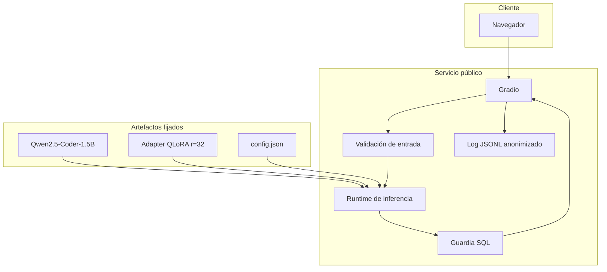

# Arquitectura de producción

## Flujo de solicitud

1. El usuario pega un DDL y escribe una pregunta en español.
2. La interfaz valida presencia de `CREATE TABLE`, longitudes y campos obligatorios.
3. El runtime carga Qwen y el adaptador QLoRA fijado.
4. El modelo genera texto de forma determinista.
5. `sqlglot` normaliza la salida y rechaza escritura o sentencias múltiples.
6. La interfaz devuelve SQL, latencia, variante e identificador de solicitud.
7. La telemetría guarda únicamente metadatos técnicos.

## Componentes

## Seguridad y privacidad

- No hay conexión a una base de datos de negocio en el despliegue público.
- La salida permitida es `SELECT` o `WITH ... SELECT` en una sola sentencia.
- No se registra el contenido del esquema ni de la pregunta.
- No se aceptan credenciales, archivos ni secretos desde la interfaz.
- Los identificadores de solicitud permiten relacionar una captura con un evento sin revelar texto.

## Observabilidad

Cada evento incluye `timestamp_utc`, `request_id`, `status`, `error_category`, `latency_ms`,
`schema_chars`, `question_chars` y `model_variant`. Antes de entregar, se exportará una muestra
anonimizada y se documentarán p50/p95, tasa de éxito y categorías de error.

## Despliegue y contingencia

La ruta principal es Gradio en Hugging Face Spaces con GPU bajo demanda. FastAPI y Next.js se
conservan como ruta local. Para la presentación se debe calentar el servicio, probarlo desde otra
sesión y mantener una demostración local o grabada si el proveedor no asigna GPU.
