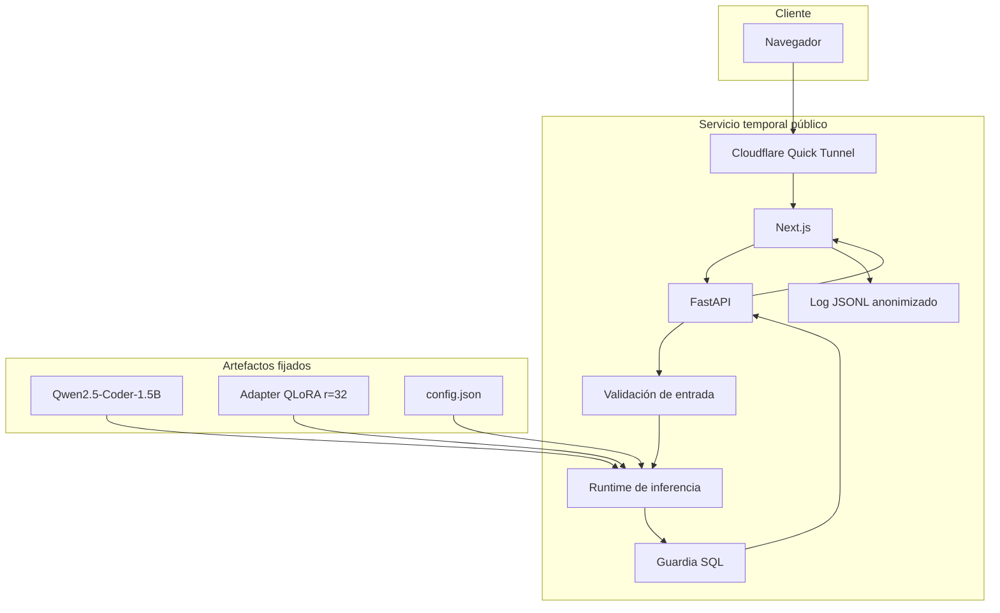

# Arquitectura de producción

## Flujo de solicitud

1. Cloudflare reenvía la conexión pública a Next.js en `127.0.0.1:3000`.
2. Next.js envía las solicitudes permitidas a FastAPI en `127.0.0.1:8000`.
3. La API valida presencia de `CREATE TABLE`, longitudes y campos obligatorios.
4. El runtime carga Qwen y el adaptador QLoRA fijado en la RTX 4050.
5. El modelo genera texto de forma determinista.
6. `sqlglot` normaliza la salida y rechaza escritura o sentencias múltiples.
7. La interfaz devuelve SQL, latencia, variante y traza de ejecución.
8. La telemetría guarda únicamente metadatos técnicos.

## Componentes

## Seguridad y privacidad

- No hay conexión a una base de datos de negocio en el despliegue público.
- La salida permitida es `SELECT` o `WITH ... SELECT` en una sola sentencia.
- No se registra el contenido del esquema ni de la pregunta.
- No se aceptan credenciales, archivos ni secretos desde la interfaz.
- Los identificadores de solicitud permiten relacionar una captura con un evento sin revelar texto.

## Observabilidad

Cada evento incluye `timestamp_utc`, `request_id`, `status`, `error_category`, `latency_ms`,
`schema_chars`, `question_chars` y `model_variant`. La evidencia exportada omite el DDL y la pregunta.
La verificación pública documenta latencias, tasa de éxito y rechazos de seguridad.

## Despliegue y contingencia

La ruta verificada usa Next.js, FastAPI y Cloudflare sobre la GPU local. El bundle Gradio queda como
ruta permanente para Hugging Face Spaces cuando la cuenta sea elegible para ZeroGPU. Los scripts de
`scripts/demo/` abren, verifican y cierran la demostración sin exponer FastAPI directamente.

El 5 de noviembre de 2026 la página pública respondió HTTP 200, los tres casos sintéticos produjeron
SQL válido y los dos casos destructivos devolvieron HTTP 422. El túnel y todos los procesos se
cerraron después de capturar la evidencia.
